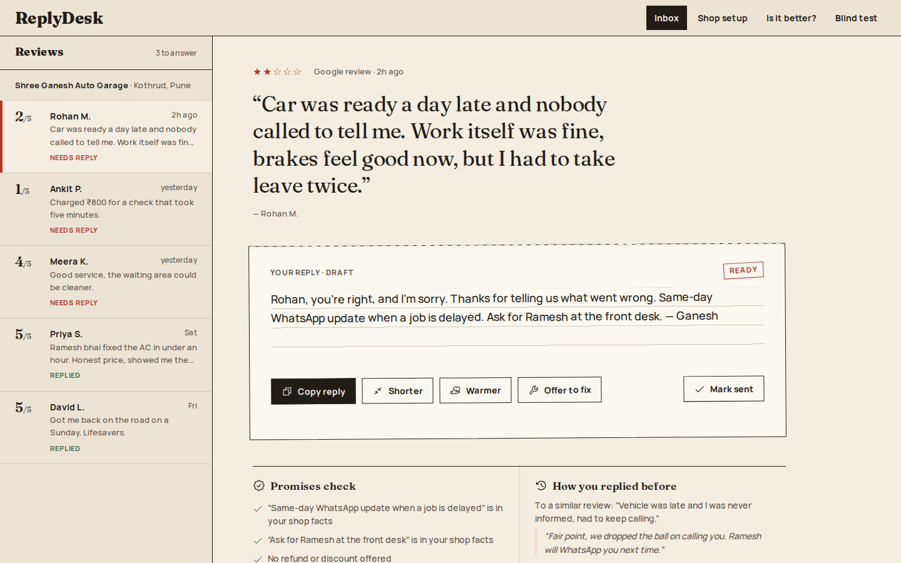
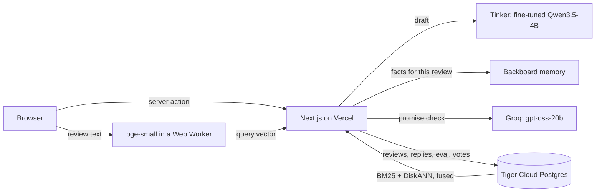

# ReplyDesk

Short, warm replies to Google reviews, written in the shop owner's voice by a small open model (Qwen3.5-4B) fine-tuned on real owner replies. Built for the Hacktoberfest 2026 DEV challenge ("Side Hustle").

Live demo: **https://replydesk-shop.vercel.app**



Small shops get reviews every week and most never answer them, because writing a good reply takes time and the replies that chat assistants write sound like a bank. ReplyDesk gives the owner an inbox of reviews, a draft reply for each one, the shop facts that matter for that review, and how they (and owners like them) answered similar reviews before. The owner edits, copies and posts it. Nothing is posted for them.

## What's inside



| Part | Used for |
|---|---|
| **Tinker** | LoRA fine-tune of Qwen3.5-4B, and serving the fine-tuned model through Tinker's OpenAI-compatible endpoint. The eval also runs on Tinker. |
| **Tiger Cloud** | Postgres 18 with `pg_textsearch` (BM25) and `vectorscale` (DiskANN). Holds the shop, reviews, sent replies, 11.5k example replies, eval results and blind-test votes. |
| **Backboard** | One memory assistant per shop. Shop facts ("Free re-check within 7 days") are saved there, and memory search picks the ones that matter for each review. |
| Groq | Checks each draft for promises the shop facts do not back. |
| Next.js 16, React 19, Tailwind 4, drizzle-orm, Phosphor icons, bun | The app. |

## The model

### Data

[Google Local Reviews](https://mcauleylab.ucsd.edu/public_datasets/gdrive/googlelocal/) from the McAuley lab at UCSD. I used four states (Wyoming, Vermont, Montana, Idaho): 590,054 review and owner-reply pairs. The raw data is not in this repo.

`ml/scripts/build_dataset.py` keeps a pair only if:

- the review and reply are in English, not machine-translated, and the reply came within 60 days
- the reply has no phone numbers, emails or links
- the business is not a chain (same name at more than 3 places) and is one of six shop types: auto repair, salon, dentist, cafe/restaurant, home services, retail
- the reply is not a template (the same text used more than twice by one business, or the same opening shared by more than 8 businesses)
- the reply shares at least one content word with the review

That leaves 50,954 pairs. Sign-offs ("Thanks, Bob", "-Ryan, Owner") are stripped because the app adds the owner's name itself. Businesses are split into train, validation and test, so no test business is ever seen in training.

The training set is filtered harder. Replies must be 20+ words, overlap the review by at least two content words, not argue with the customer or call the review false, and for 1 to 3 star reviews, acknowledge the problem in the first lines. That gives 6,000 training pairs (2,262 of them low-star).

### Training

`ml/scripts/train.py` uses `tinker-cookbook` supervised learning: LoRA rank 32, learning rate from the cookbook's helper (about 4.9e-4), batch 64, one epoch, loss on the reply only, thinking turned off in the chat template. The prompt in `ml/replydesk_ml/prompt.py` is the same one the app sends (`lib/prompt.ts`).

It took three tries:

| Run | Change | What went wrong |
|---|---|---|
| v1 | All clean pairs, 2 epochs | Learned real owners' bad habits too: "Cameron, you are obviously confused. We did not see you in the store." |
| v2 | Dropped defensive and stock replies | Polite, but bland. Many replies could have gone under any review. |
| v3 | Kept only replies that are long enough and talk about what the reviewer said | The one the app uses. Test loss 2.125. |

v3 trained on 1.28M tokens for about $0.95. All three runs together came to about $4 of Tinker credit.

### Eval

`ml/scripts/eval.py` writes a reply to 300 held-out reviews (half of them 1 to 3 stars) with four systems, then a judge from a different model family (gpt-oss-120b on Tinker) sees the four replies in random order with no labels. It marks each one and ranks them.

| | Qwen3.5-4B prompted | **ReplyDesk (4B fine-tuned)** | Qwen3.8-27B prompted | Real owner |
|---|---|---|---|---|
| Median words | 60.5 | **34** | 56 | 34 |
| Stock phrases ("we value your feedback") | 19.3% | **2.0%** | 9.7% | 7.3% |
| Specific promises (refund, call-back, discount) | 18.0% | **11.3%** | 20.3% | 12.7% |
| Mentions a detail from the review | 98.3% | **56.3%** | 98.3% | 55.3% |
| Reads like a template (judge) | 22.7% | **77.0%** | 17.0% | 63.0% |
| Judge's first pick | 40.3% | **5.0%** | 44.0% | 10.7% |
| Cost per reply | $0.00013 | **$0.00010** | not public | |
| Median latency | 0.95 s | **1.0 s** | 1.16 s | |

What this says, plainly:

- Fine-tuning made the model write like real owners. Length, stock phrases and made-up promises all moved from where the prompted model sits to where real owners sit, and stock phrases dropped below even real owners.
- The judge does not like that. It prefers the prompted models, whose replies are longer and nearly always repeat a detail back. It ranks real owners' replies near the bottom too (first pick 10.7%). So the judge rewards polish, and polish is not the same as what an owner would post.
- The fine-tuned model is a bit cheaper per reply because it writes less, and it costs nothing like a closed model.

Whether owners prefer it is a question for owners, so the app has a blind test (`/ab`): two replies to the same review, one from each 4B model, sides shuffled, and you pick the one you would send. Votes go to Tiger and show up on `/better`.

To run it again: `uv run python scripts/eval.py gen`, then `judge`, then `report` (from `ml/`). Generations and judgements are cached.

## Running the app

Needs [bun](https://bun.sh) 1.4+ and Node 22+.

```bash
bun install
cp .env.example .env.local   # optional, the app runs without it
bun dev                      # http://localhost:3000
bun run build && bun run lint
```

With no env vars the app runs offline: sample reviews, an in-memory store, and a mock reply instead of the model. Each service switches on by itself when its variable is set, and the app falls back when a call fails.

| Variable | What it does |
|---|---|
| `TINKER_MODEL_PATH` | `tinker://...` path of the fine-tuned model. Unset means mock replies. |
| `TINKER_API_KEY` | Tinker key. |
| `TINKER_BASE_URL` | Defaults to Tinker's OpenAI-compatible endpoint. |
| `DATABASE_URL` | Postgres (Tiger Cloud). Unset means the in-memory store. Apply `db/schema.sql` first, then `bun --env-file=.env.local scripts/seed.ts` for the demo shop. |
| `BACKBOARD_API_KEY` | Backboard memory for shop facts. Unset means every saved fact is used. |
| `GROQ_API_KEY` | Groq, for the promise check. Unset means a simple keyword check. |

The training side lives in `ml/` and uses [uv](https://docs.astral.sh/uv/): `extract.py` and `build_dataset.py` (data), `to_chat.py` and `train.py` (Tinker), `load_examples.py` (example replies into Tiger), `eval.py`.

## How a draft is made

1. **Setup.** The owner picks a shop type (one of the six the model was trained on), adds shop facts and, if they like, past replies. Facts are also saved to Backboard memory (one assistant per shop, only new facts are added and removed ones deleted). Past replies go into `reply_examples`.
2. **Draft.** The fine-tuned model writes the reply with exactly the training prompt. Thinking is off (`reasoning_effort: false`). The app adds the sign-off.
3. **Facts for this review.** Backboard memory search returns the facts that match the review. If Backboard fails, all saved facts are used.
4. **Similar replies.** Shown beside the draft, never sent to the model. One SQL statement on Tiger: BM25 (`pg_textsearch`) and DiskANN (`vectorscale`) each give their top 20 for the shop's type, and reciprocal rank fusion (k = 60) merges them. The owner's own past replies come first. The review is embedded in the browser (`@huggingface/transformers`, `Xenova/bge-small-en-v1.5`, in a Web Worker), so there is no embedding server. Until the model has loaded, the search uses BM25 only.
5. **Promise check.** Groq (`openai/gpt-oss-20b`) lists every promise in the reply and marks whether the facts back it. Anything not backed turns the stamp to "Check". If Groq fails, a keyword check runs instead.

Where things live: `lib/prompt.ts`, `lib/model.ts` (draft), `lib/backboard.ts` and `lib/facts.ts` (memory), `lib/guardrail.ts` (promise check), `lib/embed-worker.ts` and `lib/use-embedder.ts` (browser embeddings), `lib/data.ts` (one switch between `data-mock.ts` and `data-db.ts`), `db/schema.sql` (tables), `app/actions.ts` (server actions).

## Limits

- Training data is from four US states. Reviews in Hindi or Hinglish are not handled well yet.
- Replies are not posted to Google. The Google Business Profile API needs approval, so the owner copies the reply.
- The judge is a model, not a person. The blind test is the check that matters.
- TypeScript is pinned to 6.0.3 because `typescript-eslint` does not load on TS 7 yet.

## Credits

Dataset: Google Local Reviews, McAuley lab, UCSD. Please cite:

- Jiacheng Li, Jingbo Shang, Julian McAuley. *UCTopic: Unsupervised Contrastive Learning for Phrase Representations and Topic Mining.* ACL 2022.
- An Yan, Zhankui He, Jiacheng Li, Tianyang Zhang, Julian McAuley. *Personalized Showcases: Generating Multi-Modal Explanations for Recommendations.* SIGIR 2023.

MIT license.
