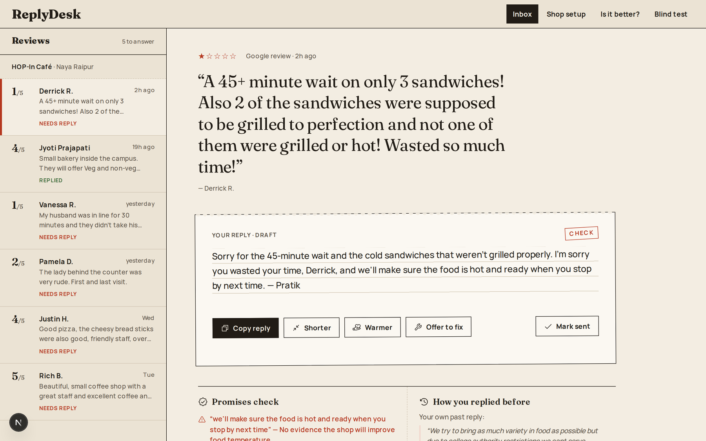
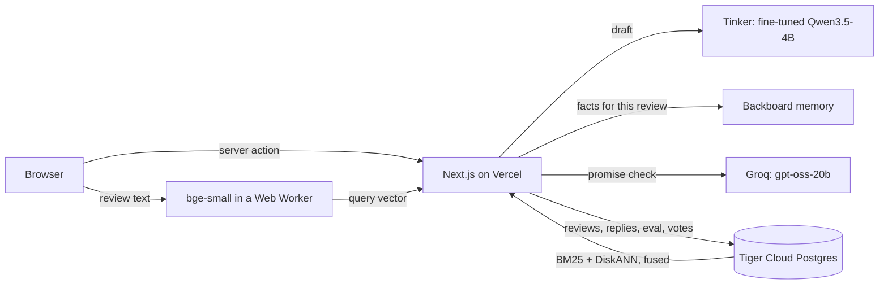

# ReplyDesk

Short, warm replies to Google reviews, written in the shop owner's voice by a small open model (Qwen3.5-4B) fine-tuned with the help of larger open models and real owner replies. Built for the Hacktoberfest 2026 DEV challenge ("Side Hustle").

Live demo: **https://replydesk-shop.vercel.app**



Small shops get reviews every week and most never answer them, because writing a good reply takes time and the replies that chat assistants write sound like a bank. ReplyDesk gives the owner an inbox of reviews, a draft reply for each one, the shop facts that matter for that review, and how they (and owners like them) answered similar reviews before. The owner edits, copies and posts it. Nothing is posted for them.

## What's inside



| Part | Used for |
|---|---|
| **Tinker** | LoRA fine-tune of Qwen3.5-4B, and serving the fine-tuned model through Tinker's OpenAI-compatible endpoint. The eval also runs on Tinker. |
| **Tiger Cloud** | Postgres 18 with `pg_textsearch` (BM25) and `vectorscale` (DiskANN). Holds the shop, reviews, sent replies, 11.5k example replies, eval results and blind-test votes. |
| **Backboard** | One memory assistant per shop. Shop facts ("Free re-check within 7 days") are saved there, and memory search picks the ones that matter for each review. |
| Groq | Checks each draft for promises the shop facts do not back. |
| Next.js 16, React 19, Tailwind 4, drizzle-orm, Phosphor icons, bun | The app. |

## The model

### Data

[Google Local Reviews](https://mcauleylab.ucsd.edu/public_datasets/gdrive/googlelocal/) from the McAuley lab at UCSD. I used four states (Wyoming, Vermont, Montana, Idaho): 590,054 review and owner-reply pairs. The raw data is not in this repo.

`ml/scripts/build_dataset.py` keeps a pair only if:

- the review and reply are in English, not machine-translated, and the reply came within 60 days
- the reply has no phone numbers, emails or links
- the business is not a chain (same name at more than 3 places) and is one of six shop types: auto repair, salon, dentist, cafe/restaurant, home services, retail
- the reply is not a template (the same text used more than twice by one business, or the same opening shared by more than 8 businesses)
- the reply shares at least one content word with the review

That leaves 50,954 pairs. Sign-offs ("Thanks, Bob", "-Ryan, Owner") are stripped because the app adds the owner's name itself. Businesses are split into train, validation and test, so no test business is ever seen in training.

The v3 training set (6,000 pairs) was filtered harder than that. Replies must be 20+ words, overlap the review by at least two content words, not argue with the customer or call the review false, and for 1 to 3 star reviews, acknowledge the problem in the first lines. That gives 6,000 training pairs (2,262 of them low-star).

### Training

`ml/scripts/train.py` uses `tinker-cookbook` supervised learning: LoRA rank 32, learning rate from the cookbook's helper (about 4.9e-4), batch 64, one epoch, loss on the reply only, thinking turned off in the chat template. The prompt in `ml/replydesk_ml/prompt.py` is the same one the app sends (`lib/prompt.ts`).

It took four tries:

| Run | Change | What went wrong |
|---|---|---|
| v1 | All clean pairs, 2 epochs | Learned real owners' bad habits too: "Cameron, you are obviously confused. We did not see you in the store." |
| v2 | Dropped defensive and stock replies | Polite, but bland. Many replies could have gone under any review. |
| v3 | Kept only replies that are long enough and talk about what the reviewer said | Wrote like an owner, but a real owner picked the long-prompt model's reply 15 times out of 19 in a blind test. Only 59% of its replies mention something the customer said. |
| **v4** | **Teacher data, shop facts in the prompt, rule filter** | **The one the app uses.** |

#### v4: a rulebook turned into training data

The long-prompt model (same Qwen3.5-4B with every rule spelled out) wrote good replies, but it needs a 348 token prompt on every call. v4 teaches those habits to the model itself, so the prompt can be half the size.

1. `ml/scripts/teacher.py` asks two larger open models (gpt-oss-120b and Qwen3.6-35B-A3B on Tinker) for replies to 2,500 training reviews, 2 candidates each, 5,000 in all. The prompt has the style guide and three real owner replies of the same trade and star bucket.
2. Half the reviews get 1 to 3 "shop facts" (like the facts a real owner saves in Setup), and the teacher is told to promise only what the facts say.
3. Free code checks (`ml/replydesk_ml/rules.py`) throw out replies that are too long or short, skip what the reviewer said, use stock phrases, argue, sign off, or promise a refund, discount, free item or call-back that the facts do not back. Openings are capped so the data is not 300 copies of "I'm sorry to hear".
4. Real owner replies that pass the same checks are mixed in, up to half as many as the teacher replies. That gives 2,584 training rows.
5. Same training recipe as v3 (LoRA rank 32), 2 epochs. The training prompt is the app's prompt, plus the shop facts block when the shop has facts.

### Eval

`ml/scripts/eval4.py` writes replies to the 300 held-out reviews with five systems and scores them. Half of the reviews come with shop facts, the way the app sends them.

| | short prompt | long prompt | v3 | **v4** | real owner |
|---|---|---|---|---|---|
| Passes every rule | 27% | 87% | 38% | **87%** | 18% |
| Mentions a detail | 90% | 94% | 59% | **91%** | 51% |
| Promises beyond the facts (reviews with facts) | 20% | 1% | 11% | **0%** | 10% |
| Prompt tokens per call | 167 | 348 | 167 | **167** | |
| Cost per reply | $0.00014 | $0.00015 | $0.00010 | **$0.00010** | |
| Judge: v4 wins head to head (100 reviews) | 52% | 55% | 81% | | 76% |

The rules were written from the same guide that made the training data, so the rule rows flatter v4. The judge (gpt-oss-120b, a different model family) is the independent row: v4 clearly beats v3 and real owners, and ties the long prompt and the short prompt.

#### The hard test: reviews that ask for money

`ml/scripts/build_bait.py` picks 150 real 1 and 2 star reviews that demand a refund, a freebie or a call-back, from businesses that are not in train, validation or test.

| | short prompt | long prompt | v3 | **v4** | real owner |
|---|---|---|---|---|---|
| Passes every rule | 5% | 49% | 21% | **69%** | 7% |
| Promises beyond the facts (code check) | 49% | 31% | 43% | **14%** | 25% |
| Promises beyond the facts (gpt-oss-120b reads each reply) | 36% | 29% | 43% | **15%** | 25% |
| Judge: v4 wins head to head (100 reviews) | 63% | 79% | 84% | | 82% |

This is the one place v4 clearly beats the long prompt: it promises beyond the facts about half as often, and the judge picks it 79 times out of 100.

#### The parts around the model

`ml/scripts/eval_retrieval.py` (Tiger search): for 120 held-out reviews, the share of the top 3 past reviews a judge marked as the same kind of situation. BM25 only 65%, vector only 71%, both fused 72%. Fusing is best, but only by a point over vectors, which is inside the noise.

`ml/scripts/eval_memory.py` (Backboard memory): 120 reviews, 46 of which need a saved shop fact. Sending every fact finds 100% of the needed ones but 25% of what is sent is useful. Memory's closest 3 finds 89% and 44% of what is sent is useful, with half as many facts. This test also found a bug: Backboard's search returns every memory up to the limit in the order they were saved, with a score that is a distance, so the first version of the app was sending almost all facts. It now sorts by score and keeps the closest 3.

#### People

The app has a blind test (`/ab`): two replies to the same review, sides shuffled, and you pick the one you would send. Votes go to Tiger and show up on `/better`. For v3 against the short prompt, a real shop owner picked v3 in 4 of 19 saved votes. The blind test now compares v4 against the long-prompt model.

To run the evals again, from `ml/`: `uv run python scripts/eval4.py gen`, then `report`, `judge`, `promise` (use `EVAL_SET=bait` for the hard test). Generations and judgements are cached.

## Running the app

Needs [bun](https://bun.sh) 1.4+ and Node 22+.

```bash
bun install
cp .env.example .env.local   # optional, the app runs without it
bun dev                      # http://localhost:3000
bun run build && bun run lint
```

With no env vars the app runs offline: sample reviews, an in-memory store, and a mock reply instead of the model. Each service switches on by itself when its variable is set, and the app falls back when a call fails.

| Variable | What it does |
|---|---|
| `TINKER_MODEL_PATH` | `tinker://...` path of the fine-tuned model. Unset means mock replies. |
| `TINKER_API_KEY` | Tinker key. |
| `TINKER_BASE_URL` | Defaults to Tinker's OpenAI-compatible endpoint. |
| `DATABASE_URL` | Postgres (Tiger Cloud). Unset means the in-memory store. Apply `db/schema.sql` first, then `bun --env-file=.env.local scripts/seed.ts` for the demo shop. |
| `BACKBOARD_API_KEY` | Backboard memory for shop facts. Unset means every saved fact is used. |
| `GROQ_API_KEY` | Groq, for the promise check. Unset means a simple keyword check. |

The training side lives in `ml/` and uses [uv](https://docs.astral.sh/uv/): `extract.py` and `build_dataset.py` (data), `to_chat.py` and `train.py` (Tinker), `load_examples.py` (example replies into Tiger), `eval4.py`, `eval_retrieval.py`, `eval_memory.py` (evals).

## How a draft is made

1. **Setup.** The owner picks a shop type (one of the six the model was trained on), adds shop facts and, if they like, past replies. Facts are also saved to Backboard memory (one assistant per shop, only new facts are added and removed ones deleted). Past replies go into `reply_examples`.
2. **Draft.** The fine-tuned model writes the reply with exactly the training prompt. Thinking is off (`reasoning_effort: false`). The app adds the sign-off.
3. **Facts for this review.** Backboard memory search returns the closest 3 facts to the review (sorted by score, since the API returns them in saved order). If Backboard fails, all saved facts are used.
4. **Similar replies.** Shown beside the draft, never sent to the model. One SQL statement on Tiger: BM25 (`pg_textsearch`) and DiskANN (`vectorscale`) each give their top 20 for the shop's type, and reciprocal rank fusion (k = 60) merges them. The owner's own past replies come first. The review is embedded in the browser (`@huggingface/transformers`, `Xenova/bge-small-en-v1.5`, in a Web Worker), so there is no embedding server. Until the model has loaded, the search uses BM25 only.
5. **Promise check.** Groq (`openai/gpt-oss-20b`) lists every promise in the reply and marks whether the facts back it. Anything not backed turns the stamp to "Check". If Groq fails, a keyword check runs instead.

Where things live: `lib/prompt.ts`, `lib/model.ts` (draft), `lib/backboard.ts` and `lib/facts.ts` (memory), `lib/guardrail.ts` (promise check), `lib/embed-worker.ts` and `lib/use-embedder.ts` (browser embeddings), `lib/data.ts` (one switch between `data-mock.ts` and `data-db.ts`), `db/schema.sql` (tables), `app/actions.ts` (server actions).

## Limits

- Training data is from four US states. Reviews in Hindi or Hinglish are not handled well yet.
- Replies are not posted to Google. The Google Business Profile API needs approval, so the owner copies the reply.
- The judge is a model, not a person. The blind test is the check that matters.
- TypeScript is pinned to 6.0.3 because `typescript-eslint` does not load on TS 7 yet.

## Credits

Dataset: Google Local Reviews, McAuley lab, UCSD. Please cite:

- Jiacheng Li, Jingbo Shang, Julian McAuley. *UCTopic: Unsupervised Contrastive Learning for Phrase Representations and Topic Mining.* ACL 2022.
- An Yan, Zhankui He, Jiacheng Li, Tianyang Zhang, Julian McAuley. *Personalized Showcases: Generating Multi-Modal Explanations for Recommendations.* SIGIR 2023.

MIT license.
